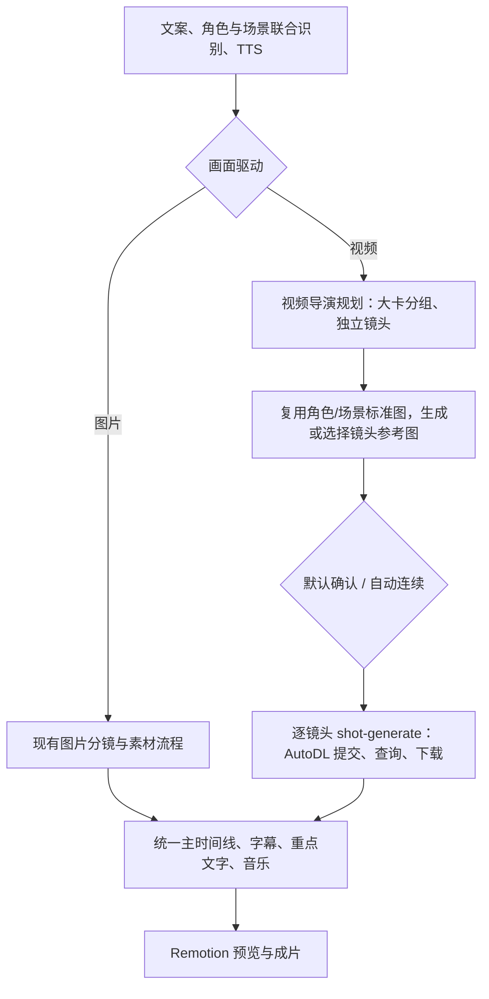

# AI 视频驱动管线实施规划与 Agent 执行 Prompt

日期：2026-10-14。代码基线：项目更新 0.80.0，包含当前工作区尚未提交的角色/场景修改。本文是待实施规划，不代表功能已经上线。

## 1. 最终建议与首期边界

**保留“大分镜卡”的组织方式，底层每个子镜头独立生成视频。** 大卡“一键生成”是批量提交子镜头任务。修改一个子镜头，只使它的视频过期；涉及共享角色、场景或相邻切点时，按实际依赖使相关镜头过期。

单镜头可以是 12–15 秒的连续长镜头，不必为了使用单镜头模式而强行切短。大卡按旁白语义组织，可以包含多个镜头；15 秒限制属于一次服务商请求，不属于 UI 分组。

| 项目 | 首期实施 | 后续再做 |
| --- | --- | --- |
| 画面管线 | 图片驱动、AI 视频驱动两个项目级选项；老项目默认图片 | 同一项目图片/视频混合 |
| 生成粒度 | 每个逻辑镜头一个独立视频；大卡批量触发 | 一次请求生成多个镜头、共享长视频中的片段替换 |
| 视频服务商 | AutoDL `minimax_h3_zm_u08`，1–15 秒整数请求时长 | 更多模型、其他 H3 工作流 |
| 输入图片 | 先生成或选择镜头参考图；默认确认后生成视频；可开启自动连续生成 | 真正固定首帧/尾帧的另一种工作流 |
| 图片作用 | 人物、场景、构图参考，不承诺第 0 秒复现 | 精确关键帧约束 |
| 声音 | 现有 TTS、音乐、音效；生成视频音轨在合成时静音 | 模型原生声音及与 TTS 的选择/混音 |
| 文字 | 每镜都有视频，重点文字与字幕叠加 | 模型生成可读文字、原生口型同步 |
| 编辑与重试 | 独立编辑、重生成、候选选择、保留满意素材 | 自动识别切点、剪辑器、跨镜头视频编辑 |

一次生成多镜头的优势是内部动作、光线和切换可能更连续，提交次数较少；劣势是某一镜头失败要重做整段、切点不可精确依赖、候选组合和局部替换更难。逐镜头生成更适合本项目的编辑卡、缓存和重试体系，但相邻镜头可能出现人物位置、光照、动作接续差异，且每次请求取整可能增加计费秒数。首期用共享角色/场景参考和明确动作起止缓解一致性问题，不承诺模型必然保持一致。

可选整段多镜头模式放在独立后续阶段：只有同人物、同场景、连续动作且已确认内容的段落才使用。届时明确显示“改一个镜头需重做整段”，不能把它包装成默认独立生成的同一种编辑体验。

## 2. 必须复用的当前能力

| 当前入口 | 最新行为与实施要求 |
| --- | --- |
| `lib/pipeline/stages/cast.ts`、`lib/core/cast.ts`、`lib/core/scenes.ts` | 已联合全文识别角色和场景。保留现有 ID、用户字段、上传和锁定；不另建选角/场景识别器 |
| `settings.autoPortrait`、`lib/pipeline/auto-portrait.ts` | 已共用一个开关生成角色立绘与场景标准图。保持字段兼容，不增加第二套自动标准图调度 |
| `lib/server/jobs.ts` | `shot-generate` 领取时已等待关联的活跃角色/场景标准图任务；等待结束不代表镜头参考图已确认，须补独立确认门 |
| `lib/pipeline/stages/shot-generate.ts` | 已有 image/video 输入、候选历史、逐候选缓存与写回。复用视频输出路径；参考图生成须写入独立输入槽 |
| `lib/core/shot-asset.ts` | 已按候选恢复素材 kind 和来源指纹。延续“重生不自动顶掉已选择素材”的规则 |
| `lib/core/timeline.ts`、`lib/pipeline/artifacts.ts` | TTS、字级锚点、停顿、片头/片尾时长由主时间线唯一派生；禁止另建视频时间线 |
| `lib/providers/runs.ts`、素材库、缓存、ledger | 用现有生成记录保存远端任务恢复信息，用本地素材库保存 MP4；首期不加表、不迁移数据库 |
| 模型 catalog/registry、现有模型中心 | 增加 AutoDL 视频模型，延续现有模型 ID 组合与配置方式 |

需要明确修正的现状：全量生成路由与制作页仍写死 image；视频复用图片提示词；媒体请求尚无实际时长；`VideoShot` 仍 `muted loop` 并套外部图片运镜；自动生产的 preview readiness 尚不检查视频素材是否齐备。这些都是首期实施点。

现有 `settings.modelId` 是**文本模型**，不能直接改成视频模型。现有 `candidateGroupId` 是**一次生成的候选批次**，不能充当大卡分组 ID。

## 3. 两条业务管线，共用执行基础设施



“分两个管线”体现为不同导演提示词、分镜规则、参考图步骤与素材就绪条件。web、worker、jobs、SQLite、缓存、素材和 Remotion 共用，不复制第二套 worker、计划引擎或队列。

### 3.1 最小数据契约

以下字段名作为执行默认契约；A 与统筹在第一波一次冻结，其他 agent 不自行改名。新增字段使用可选值/default 兼容旧文档，不批量转换已有项目。

| 位置 | 新增/复用契约 |
| --- | --- |
| `Settings.visualPipeline` | `image \| video`，默认 `image`；首期不放入 mixed |
| `Settings.video` | `{ modelId, referenceImageModelId, resolution, autoContinue }`；默认 AutoDL 模型、`768p`、`autoContinue:false`；参考图模型来自现有可用图片模型 |
| `Shot.groupId` | 可选语义分组 ID；`doc.shots` 仍扁平、按现有锚点排序，无嵌套 `subshots` 或另一个组时间线 |
| `Shot.videoPlan` | 可选 `{ startState, action, camera, endState }`；起始构图、动作变化、相机运动与结束状态。视频生成内容与参考图静态内容区分 |
| `Shot.sourceImageAssetId` | 镜头选定参考图；不占用输出 `assetId`，不映射成 H3 固定 firstFrame |
| `Shot.sourceImagePromptHash` | 生成参考图时的内容指纹；手动选图来源可为 unknown。用户选图不因缺少生成指纹被自动覆盖 |
| `Shot.sourceImageConfirmedHash` | 用户已确认的参考输入快照指纹，覆盖选图及当时内容/风格/关联参考；图片或相关内容变更后需重新确认 |
| `Shot.sourceImageDescription` | 上传/选用图片的简短说明；自动生成图复用已知描述。文本 LLM 无法看图时不伪造图片内容 |
| `Shot.assetId/assetVariants/candidates` | 继续只承载最终输出素材和候选；视频管线输出候选为 video，图片源图单独选择。已有混合历史候选按 candidate.kind 预览 |
| `Artifacts` → `TimelineShot` | 传入所选视频素材实测时长/尺寸等；派生 `videoTrimStartMs`、可播放长度、末帧保持长度，不把 I/O 放进 core |

不要另外持久化 queued/running 等镜头状态；从 jobs、生成记录、指纹和素材存在性派生。素材实际 duration/尺寸存在 assets；需要 fps 时扩展现有 ffprobe/metadata，不新增媒体探测系统。

### 3.2 时长与播放规则

1. 收费生成视频前必须有覆盖句子的真实 TTS。从最终 `buildTimeline` 取镜头区间，包含自然停顿、开头 500ms、末尾 1500ms，以及已有边界调整；不要按字数重新估算。
2. `targetDurationMs = endMs - startMs`，`requestDurationSeconds = ceil(targetDurationMs / 1000)`。请求合法范围为 1–15；实际不足一秒的边界镜头可请求 1 秒后裁到主时间线长度，不能把主时间线静默延长为 1 秒。
3. 区间超过 15 秒时按现有 `lineId + char` 合法锚点细分，保留 groupId。先尝试句间/语义边界，必要时使用已有字级锚点；锁定镜头需要用户处理，不能偷偷拆开。拆分必须发生在参考图确认和视频提交前。
4. 独立视频镜头不经过图片分镜“前段最大 3.5 秒、后段最大 6 秒”的限制。导演优先清晰单动作，常见 3–8 秒；连续动作可到 15 秒。
5. 下载后用本地 ffprobe 实测，不使用查询响应中的 `data.duration`（它表示任务耗时）。视频多出的尾段裁掉；源视频比目标短的差值不超过 100ms 才允许末帧保持，超过则标记无法满足时长，供重试/重新规划。
6. 视频不循环、不全局变速配音，不叠加图片的推拉摇移。首期默认硬切，不增加 AI 视频镜头转场重叠；这样 15 秒上限不会被 overlap 扩长，后续再处理跨镜头过渡。
7. 重算切点可能改变相邻镜头区间；使真正受影响的镜头过期，不保证所有修改都只影响一个镜头。纯分组标题/展开状态、字幕样式、重点文字样式变化只重渲染，不重生视频。

输出沿用 outputSpecs/assetVariants 与现有画幅策略；视频默认共享主画幅源素材裁切输出。需要独立画幅生成时沿用现有 independent 选择，并在开工前显示额外任务数。H3 的 768p 生成分辨率与成片 1080p 输出分辨率分别展示，不因导出规格重复生成相同源视频。

## 4. 角色、场景与参考图规则

视频中的**镜头参考图确认**与角色/场景**标准图自动生成**是两个步骤。只新增前者的确认门，保留现有联合模块与自动标准图行为。

- 参考图生成继续使用角色身份锚、按 lineId 生效的 `lookAt` 造型、场景 description/style、visualStyle；图片编译器处理静态 `startState`，不把整段动作写成一张图。
- 视频输入固定 `ref_image_0 = sourceImageAssetId`；附加场景标准图、镜头专属参考、角色参考按稳定顺序去重，并记录最终送出的 asset ID 与 Picture 编号。当前公共 bundle 上限 8；AutoDL 公开槽为 0–8（最多 9）。首期附加图沿用现有 bundle 上限，加入主图后再次去重，按服务商真实限制裁剪。
- 自动场景图过期时现有代码会略过图片、保留文字；角色参考当前可能继续包含旧立绘，不能宣称角色/场景失败都已自动退回纯文本。视频路径保护上传图，过滤已可判断过期的自动参考，缺少辅助标准图可用文字继续生成**镜头参考图**。
- H3 必需的镜头参考图缺失时必须等待/重试/手选；不能降级为纯文生视频。用户手动选择已有图不被自动替换。
- 默认图准备好后显示“待确认参考图”；点击确认只记录当前快照。重新生成参考图、改人物造型/场景/风格会清除有效确认；只改动态相机或动作且不影响起始画面时，可保留同一参考图，视频仍过期。
- 自动连续选项只跳过人工确认，仍等待标准图任务终结、参考图成功、真实 TTS 与合法时长。开启后属于既有开工确认中会产生费用的设置，纳入 `setupFingerprint`；不新增另一套审批流程。
- 修改/锁定与生成并发时，沿用当前快照校验与 `ctx.current()/lockToken`。旧请求结果可入素材库/生成记录供找回，不自动替换最新镜头素材，也不能把新状态标成“已完成”。

## 5. 导演系统提示词与 H3 提示词

### 5.1 两层职责

现有文本 LLM 一次规划整片：输出独立镜头、语义分组、合法锚点、角色/场景绑定与连续动作。H3 编译器再把单镜头计划、最终参考包和实际请求秒数编译成字符串。首期不增加“看图 VLM → 改写 LLM → H3”的多次调用。

**视频导演系统提示词基稿：** B 在现有 storyboard 输出 schema 上加入字段并落实，不建立第二套全文识别。

```text
你是旁白视频导演。输入包含原文、真实 TTS 的句子/字级时间、现有角色卡、场景卡和视觉风格。
只根据输入事实设计画面，不重写旁白，不新增无依据的人物或地点。
按旁白语义将镜头组织为 groupId；组只用于界面组织，每个输出 shot 都独立生成一个连续视频。
沿用输入的 lineId + char 作为开始锚点，覆盖完整旁白且无重叠、遗漏；时长由程序推导。
每镜为一个连续镜头，通常 3–8 秒，确有连续动作可更长，但最终区间不得超过 15 秒。
不要为填满 15 秒而加入无关动作，不在单镜头里安排剪切/蒙太奇。
为每镜写：startState（起始构图）、action（动作发展与先后）、camera（明确运动）、endState（结束状态）。
videoPlan 的描述使用英文；用户阅读的 intent/description 使用中文。
动态描述说明谁、在哪里、如何移动、对象怎样变化、动作如何结束；避免互相冲突的相机指令。
角色身份/服饰来自现有角色卡与该句造型，场景来自合法 sceneId；每个镜头都绑定需要的人物/场景。
重点文字写进现有 focusText，由后期叠加；每镜仍要可生成的视频画面，不输出独立 motion/真实素材卡。
旁白由外部 TTS 播放；不要求角色说出旁白、口型配合、声音或背景音乐，不要求模型绘制字幕。
上传图片的内容只能使用用户说明，不能声称已视觉检查图片。
输出严格匹配提供的 JSON schema；只输出规划，不输出推理过程。
```

### 5.2 H3 Ref2VA 编译规范

采用 MiniMax 官方 Full-Reference 格式，依次输出六个英文段落名：`subject_definitions`、`summary`、`retention_analysis`、`detailed_description`、`overall_soundscape`、`non_diegetic_music`。整个内容作为请求 `prompt` 字符串，不把六个段落误当 API 的六个参数。

- `<Picture 1>` 对应 `ref_image_0`，后续 Picture 编号与最终送出顺序一致；`<Subject N>` 定义可复用人物/场景，同一个标签全篇同义。
- 图片仅提供身份/场景指导时，在 Subject 定义中引用 Picture；不声明它必然是首帧。summary 用 `[reference generation]`。
- `retention_analysis` 使用官方 `fully_preserved/partially_preserved/attribute_transfer/weak_reference` 标记，写具体保留关系，不写模型思维过程。
- 首期仅 `[Shot 1]`，没有切点时间戳。详细段先写风格，再写起始构图、动作、相机与结束状态；重要动作在 targetDuration 内完成，取整后的多余尾段保持自然收束。
- 官方建议 generation 的 detailed_description 通常 350–500 英文词。先确保可见内容和运动明确；不为凑词数新增一次 LLM 调用，紧凑模板效果留待小样判断。
- `overall_soundscape: N/A`、`non_diegetic_music: N/A`，明确不要对白；合成仍强制静音。官方格式支持声音，当前工作流未公开音轨关闭参数，不能宣称提示词会保证无声。

单镜头编译示例（人物描述来自已有卡片/图片说明）：

```text
subject_definitions:
<Subject 1> is the researcher described in <Picture 1>, wearing the referenced white coat.
<Subject 2> is the laboratory environment described in <Picture 2>.
summary:
[reference generation] A continuous 6-second shot shows <Subject 1> lifting a sample in <Subject 2>.
retention_analysis:
<Subject 1> (appears in [Shot 1]): fully_preserved - retain identity and the white coat.
<Subject 2> (appears in [Shot 1]): fully_preserved - retain the laboratory setting and lighting.
detailed_description:
Use the project's cinematic visual style and consistent soft laboratory lighting.
[Shot 1] In a medium shot, <Subject 1> stands beside the laboratory bench in <Subject 2>.
The researcher lifts one vial slowly, turns it toward the light, then holds it steady for inspection.
The camera makes a gentle forward move without cutting. Complete the inspection before the final hold.
Maintain the subject's identity and stable object geometry. No dialogue, subtitles, or background music.
overall_soundscape:
N/A
non_diegetic_music:
N/A
```

示例用于说明字段/标签，不是已验证质量的最终模板。后续整段多镜头模式才使用 `[Shot 2] At 00:03.000, ...`；首镜不写时间戳，切点只能作为节奏指导，不能充当真实媒体剪切依据。

## 6. AutoDL 接入、恢复与成本

已核对的公开工作流合同如下；C 开始实现时只重新核对这一个 schema，避免扩大调研。

```text
POST https://autodl.art/api/v1/comfyui/comfyui_workflow/minimax_h3_zm_u08
GET  https://autodl.art/api/v1/comfyui/comfyui_workflow/result/{task_id}
Authorization: <ComfyUI 分组 token 原文，不加 Bearer>

{"prompt":"...", "duration":6, "resolution":"768p竖",
 "ref_image_0":"data:image/png;base64,...", "seed":123}
```

duration 为整数 1–15，prompt 1–20000 字符；参考图 0 必填，1–8 可选。分辨率枚举包含 `480p竖/768p竖/480p横/768p横/480p(1:1)/768p(1:1)`，由画幅与 video.resolution 映射。首期不传 audio、first_frame、last_frame 或输入视频等未支持字段。

模型中心登记 `autodl::minimax_h3_zm_u08`，token 通过 server 环境变量 `AUTODL_API_TOKEN` 配置（沿用现有 env 凭证方式）；前端仅显示可用状态，不输出 token。不能将它注册成自定义 OpenAI-compatible 视频接口，当前 custom 接入只覆盖 text/image。

**最小恢复协议，保存在 `generation_runs.params`：**

1. 生成请求入队时把稳定 `attemptId` 写入 jobs.input；它表示一次用户要求的生成尝试，恢复创建新 job 时仍沿用原值。按 `attemptId + requestHash + candidateIndex` 创建/查找同一生成记录，jobId 仅记录执行来源。在调用 POST 前持久化 `submissionStarted`；已有 taskId 就恢复查询，已有输出素材就复用。
2. 收到 `code:"Success"` 和 taskId 后立即保存 `providerTaskId`，然后 polling。常见 QUEUED/RUNNING/SUCCESS/FAILED 与示例 `completed` 归一；未知状态有限等待后报清晰错误。
3. POST 超时、断连，或 worker 在提交后写 taskId 前崩溃，都可能已经收费。没有 taskId 的未决提交标为 `submissionUnknown`，停止自动重提；恢复时识别持久化的 submissionStarted，不能因 crash 丢掉防重复状态。
4. 查询/下载失败只恢复原 task，不能再调用生成 POST。已明确拒绝或远端终态失败的请求，区分是否允许重试；收费重生成由用户明确操作触发新的 generation attempt。
5. 成功结果提取 `results` 中 video/mp4 的 URL，立刻有上限地流式下载、校验并 `putFile` 入库，再实测时长。复用现有 200MB 上限，避免先 arrayBuffer 整个大视频再检查大小。
6. 本地停止中断轮询和后续提交，但无公开远端 cancel 合同，不能显示“云端已取消/未收费”。保存 taskId 与 attemptId；恢复原尝试只取回/继续查询，只有“重新生成”才开启新付费尝试。新 goalId/新 jobId 不得绕过原尝试的 submissionUnknown；状态接口向前端返回原 attemptId。
7. 结果 URL 有短期有效期，但精确 TTL/可刷新规则未确认。过期后尝试重查原 task；仍不能取回时显示明确失败，不能悄悄生成新视频。

指纹统一使用最终快照：管线、prompt/compiler 版本、workflow、模型、实际目标与请求时长、覆盖旁白/TTS、画幅/分辨率、seed、最终参考 asset IDs、角色造型/场景/风格。缓存、候选来源、UI 过期判断和调度使用同一生成快照，避免“界面新鲜、实际命中旧视频”。分组名与后期字幕样式不纳入视频生成指纹。

新增 `runs.ts` 恢复查询/事务 helper 即可；远端状态、输出 URL、最终请求参数不含 token/base64 图片正文。调度层负责 job 租约与 current 校验，adapter 通过最小回调/恢复上下文持久化进度，不另建通用异步任务框架。视频并发首期固定保守上限 2：D 在 `jobs.claim` 原子领取时额外检查 running `shot-generate` 的 input.kind=video 数量；stage 总上限维持当前值，不能只把共用 stage 的 concurrency 改成 2，否则会同时降低图片并发。

计费沿用现有 pricing/ledger：单价页面可用作未核实估算，但“按请求秒数还是实际输出秒数扣费、失败/取消是否收费”尚未确认。保存请求秒数、`costStatus:unknown/estimated/verified`；未知费用不显示成“免费/0 元”，也不能声称预算硬上限已覆盖未知费用。已知实际金额使用 ledgerId 幂等记录，不新建计费系统。

## 7. 调度与 API 的最小增量

- 新增一个 `shot-reference` stage，专门生成镜头输入图，复用现有图片生成/参考包/缓存/自动标准图依赖。独立 stage 能避免参考图覆盖最终视频候选；不要将它伪装成输出图片候选。
- `shot-generate` 保留为输出媒体 stage，增加 video 分支与 AutoDL 恢复上下文；已有图片路径保持原行为。
- plan 在视频路径按“真实 TTS → 视频分镜 → 标准图终结 → 镜头参考图 → 确认/autoContinue → 视频”推进。确认期间放在 `waiting`，不让未确认任务占用 worker，也不让轮询反复入队。
- 有效参考确认成功后重新 drive 当前生产目标；关联标准图任务终结时也触发相关项目重算，即使该标准图任务没有匹配 goalId。当前 waiting 可能表现为 blocked，必须能自动解除这种可恢复等待，不能要求用户把“待确认”当失败重新开工。
- 为新参考图 stage 复用现有角色/场景依赖判断；当前判断只针对 `shot-generate`，不要遗漏新增 stage。
- 视频 preview/render readiness 增加所需画幅的视频素材齐备、当前输入指纹匹配与可播放时长条件；浏览器编辑预览仍可显示占位，收费导出不把未完成镜头当完成。
- `currentKeys/goalId` 纳入真正的参考图与视频任务。先等标准图任务终结再固定 refs；写回自身源图或产物不使当前 job 被误取消，用户真实修改则阻止旧结果采用。

路由约定（D 所有，E 按此接入）：

| 接口 | 行为 |
| --- | --- |
| 现有 `POST /api/projects/{id}/shots/{shotId}/generate` | kind=image 保留；kind=video 校验当前管线、参考确认、时长；operation=generate/resume/regenerate。resume 必须带 resumeAttemptId 并匹配当前快照；regenerate 才新建 attemptId |
| 现有 `POST /api/projects/{id}/shots/generate` | 支持视频批量；可选 shotIds 限定大卡，省略则全量；只补缺失/过期且未锁镜头。继续批次沿用各镜原 attemptId；发现原请求未决时等待处理，不重新 POST |
| 新 `POST /api/projects/{id}/shots/{shotId}/reference` | 生成参考图，或选择已有 assetId；用户选图保护，返回确认所需 snapshotHash |
| 新 `PATCH /api/projects/{id}/shots/{shotId}/reference` | 以 `confirmHash` 确认当前快照；不匹配返回冲突，不能确认过时图片 |
| 现有 shots/status、generate/cancel、候选 PATCH | 扩展 video/reference 状态，返回每镜待配音/待图/待确认/查询中/下载中/失败；沿用批次与取消机制 |

route 只校验、修改文档和派发 job，重活在 worker。图片未确认、锁定、缺配音和时长超限的错误须可操作；不要为这些状态增加新页面或另一套 SSE。

## 8. Agent 分工、档位与执行顺序

全部使用 `gpt-6.1-sol`。下表档位指 reasoning effort，速度选项是另外的设置；档位建议属于任务分工判断，不是价格/质量保证。首期无需 max/ultra。

| Agent | 档位 | 独占文件/边界 | 交付 |
| --- | --- | --- | --- |
| 统筹 | high | `lib/changelog.ts`、必要 `docs/ARCHITECTURE.md` 更新、最终集成；不与 owner 同时编辑其文件 | 冻结合同、组织波次、验收、最终说明 |
| A 领域、时间与指纹 | high | `lib/core/{types,shots,timeline,keys,shot-asset,production,preset}.ts`；新 `lib/core/video.ts`；`lib/pipeline/artifacts.ts`；相邻领域测试 | 兼容 schema、时长计划、快照/hash、播放 props |
| B 视频导演与提示词 | medium | `lib/prompts.ts`、`lib/pipeline/stages/storyboard.ts`；新 `lib/core/video-prompt-compiler.ts`；相邻提示词测试 | 独立视频导演、静态源图/动态视频编译、合法角色场景绑定 |
| C AutoDL 与恢复 | high | `lib/providers/{types,catalog,registry,runs}.ts`、新 `lib/providers/media/autodl.ts`、`lib/pipeline/media-gen.ts`、必要 pricing/config、`lib/server/media.ts/ffmpeg.ts` 最小增量 | 远端提交/查询恢复、下载探测入库、成本来源 |
| D 生产编排与 API | high | `lib/pipeline/plan.ts`、`stages/shot-generate.ts`、新 `stages/shot-reference.ts`、`stages/index.ts`、必要 runtime；`lib/server/jobs.ts`；shots 下上述路由、必要 produce route/worker 薄接线 | 参考确认门、批量/单镜生成、就绪门禁、停止/恢复 |
| E 制作页 UI | medium | `components/video-studio.tsx`、`components/studio/{settings-panel,storyboard-panel}.tsx`、必要 `lib/core/step-status.ts`；薄组件 | 项目管线选择、大卡折叠、源图确认、独立操作与状态 |
| F 合成与播放 | medium | `remotion/shots/video.tsx`、必要同目录/layers/animation 小改及针对性验证 | 静音非循环、裁尾/小幅末帧保持、文字叠加、统一预览 |
| G 定向验收 | low | 只读检查和执行已列命令；发现复杂问题交回 owner | 简短验收证据，不自行扩大测试/重构 |

相关角色/场景文件不安排重写；如确有缺口，由统筹串行指定原 owner。跨模块补改也先交回文件 owner，不由多个 agent 抢写。

**当前环境总并发 4（含统筹），按三名执行者上限排波次：**

1. A 先冻结字段、helper 导出与 fingerprint；统筹同时冻结 D/E 的 API 入参/返回状态和 C/D 的恢复回调合同。A 不做 UI/provider 实现。
2. B、C、F 并行；分别基于 A 契约落地。C 给 D 提交可恢复的媒体调用接口；B 给 D 交付编译函数。
3. D、E 并行。D 使用 B/C 已完成接口；E 使用已冻结 API 合同，联调前不自行改 route。A/B/C/F 只在确有集成缺口时补丁。
4. G 执行短验收；统筹处理跨模块问题，一次运行全仓 typecheck/lint，登记重大更新并确认 changelog 页面。达到下述停止条件即结束。

不让每个 agent 全仓 typecheck/lint/build。不要为了本功能全仓重构、整理类型、格式化或增加 SDK；目前工作区含大量角色/场景未提交改动，禁止 reset/stash/覆盖已有差异。

## 9. 可直接复制的执行 Prompt

使用方法：统筹使用 9.1；子 agent 的完整 prompt = **9.2 通用前缀 + 对应模块块**。以 `fork_turns:none` 配合精简 prompt 与本文路径，不复制整段研究历史。模型/档位须在启动配置中指定；只在文字里写“用 high”不会改变运行配置。

### 9.1 统筹 Prompt — gpt-6.1-sol / high

```text
在 F:\office_share\DO-Vedio 实施 docs/ai-video-pipeline-plan.md 的首期 AI 视频管线。
先读 AGENTS.md、docs/ARCHITECTURE.md、lib/changelog.ts 和该规划；保护当前未提交角色/场景修改。
目标：项目可选图片/视频驱动；AutoDL minimax_h3_zm_u08 参考图视频；语义大卡+逐镜头独立生成；
默认确认镜头参考图，autoContinue 可选；使用真实 TTS；静音非循环视频、字幕/重点文字叠加。
按规划独占文件划分启动 Sol 6.1 子 agent：A high；B medium；C high；D high；E medium；F medium；G low。
总并发最多 4，先 A 冻结合同，再 B/C/F，最后 D/E。提前固定 API 和远端恢复回调合同，禁止共享文件并发写。
复用 0.80.0 联合角色/场景分析、autoPortrait+autoScene、jobs、generation_runs、素材库、时间线与候选。
不开发 mixed、单请求多镜头、模型原生音轨、VLM、自动剪辑或新后端，不增加泛化框架/新依赖/新表。
每个 agent 只跑其必要定向测试；你统一检查关键边界，并在整合后运行 npm run typecheck、npm run lint。
完成后更新 lib/changelog.ts 顶部重大版本、确认 /changelog 渲染；更新架构地图的相关入口。
按规划第 10 节验收；mock 验证协议，未获具体付费调用授权不消耗用户服务额度。
仅在功能验收实际完成后将本规划移入 docs/archive；未完成则保留并写清阻塞，不宣称上线。
返回：完成行为、改动文件、检查结果、未验证的远端合同/质量及运行所需配置。达到停止条件后结束。
```

### 9.2 所有子 Agent 通用前缀

```text
工作区 F:\office_share\DO-Vedio。实施 docs/ai-video-pipeline-plan.md 中我负责的首期模块。
先读 AGENTS.md、docs/ARCHITECTURE.md、lib/changelog.ts、该规划，再按符号定向读代码；不要通读仓库/无关 docs。
当前存在已暂存和未暂存的角色/场景改动，保留原行为与差异；不 reset/stash，不自动提交或清理用户文件。
涉及 Next 路由/组件时，写代码前只读对应 node_modules/next/dist/docs 指南。
只编辑本模块独占文件和必要相邻测试；共享文件合同交统筹与 owner，不抢写。
按 A 冻结的字段/helper 与统筹 API 合同工作；没有合同先反馈依赖，同时完成不依赖它的部分。
不实现后续功能，不引入新依赖/任务框架/数据库迁移，不做大重构或测试重构。
关键逻辑用必要定向测试验证；UI 以短手工检查为主。禁止付费 API 调用和自行全量测试/build。
交付格式：实现结果；修改文件；导出函数/API 合同；实际验证命令/结果；需要统筹处理的缺口。
```

### A：领域、时间与指纹 — high

```text
独占规划第 8 节 A 的文件。最先完成并发布给统筹的 schema/helper 契约。
增加默认 image 的 visualPipeline、独立 settings.video、groupId、videoPlan 和独立 sourceImage 字段。
settings.modelId 保持文本模型；candidateGroupId 保持候选批次；doc.shots 保持扁平。
基于最终 buildTimeline 的真实 TTS、停顿与 lead/tail 推导 targetDurationMs/ceil 请求秒数。
视频分镜走独立限制，超过 15 秒用现有字符锚点拆分；不擅自拆锁定镜头或改变整片配音时长。
明确关闭首期 AI 视频转场 overlap/图片运镜自动编排，不让 choreography 把 video 变回文字卡。
定义纯函数生成快照/hash，给 B/C/D/E 同一来源；源图指纹与视频动态/时长指纹分开。
复用候选/assetVariants，候选换回旧视频保留其旧来源，unknown 不能伪装为当前生成。
通过 artifacts 传入已入库视频的实际时长，timeline 派生播放裁尾和 <=100ms 末帧保持参数；core 禁止 I/O。
将新增成本设置纳入 setupFingerprint 与 preset 明确分组，确认后参数变化不会绕过既有开工确认。
只验证旧文档默认、TTS/尾部/15秒边界、局部失效与候选回退。不要实现 provider、UI 或第二条时间线。
```

### B：视频导演与提示词 — medium

```text
独占 lib/prompts.ts、stages/storyboard.ts、新 lib/core/video-prompt-compiler.ts 及相邻测试。
实现规划第 5 节系统提示词，图片分镜分支保留，视频分支输出扁平独立镜头/groupId/videoPlan。
所有视频镜头均关联合法角色/场景，重点文字写 focusText 并以后期叠加表现，不输出独立 motion/real 卡。
沿用已有角色身份锚、lookAt 与场景描述，复用全文联合识别，不新增识别/VLM 调用。
静态参考图取 startState；动态 H3 prompt 取动作、相机、endState 和实际秒数，标签映射基于最终 refs。
编译六段英文 Ref2VA 字符串，summary=[reference generation]，首期仅 [Shot 1] 无 cut 时间戳。
retention_analysis 用官方关系标记；不把参考图宣称固定首帧；N/A 音景/配乐，不加入外部旁白或字幕。
手选图片只用用户说明，文本模型不声称已看图。不要为编译新增一次 LLM 调用。
给 D 导出纯编译函数、版本和输入类型；给参考图 stage 导出静态描述编译入口。
用两三个有效案例验证角色造型/场景/标签顺序、单镜头无切点、图片分支未改变；不做大规模提示词评测。
```

### C：AutoDL 与恢复 — high

```text
独占规划第 8 节 C 的文件。窄查 AutoDL 工作流 schema 与官方 H3 参考格式，随后实现，不扩大研究。
登记 autodl::minimax_h3_zm_u08 视频模型，AUTODL_API_TOKEN 仅 server 使用，Authorization 不加 Bearer。
实现单镜参考生成、resolution 映射、1–15整数 duration、required ref_image_0，沿用本地图片 data URI。
给 MediaRequest 增加实际时长和最小可恢复上下文；沿用现有媒体路由，图片/Replicate 原行为保留。
generation_runs.params 记录 attemptId、submissionStarted、taskId、最终 refs/params、输出 URL、阶段与 costStatus。
按 attemptId+requestHash+candidateIndex 恢复；新 jobId/goalId 不能产生新尝试。写 taskId 后才 polling。
POST 未决和提交后写ID前崩溃禁止盲重提；同快照存在未决尝试时不允许普通 generate 绕过。
查询/下载失败只恢复原 task；AbortSignal 可停止本地等待，不能冒充远端取消。输出失败不自动花钱重生成。
有上限流式下载 MP4，用 putFile 入库，复用 ffprobe 获取实测 duration/尺寸，必要时加 fps metadata。
不信 data.duration 为视频时长；短时 URL 过期先重查原 task；校验类型、空结果、超限、时长明显不足。
未知价格保留 unknown，已知成本用既有 ledger 幂等写入；不新建表、迁移或通用异步框架。
用 mock 验证提交成功、原task恢复、submissionUnknown、下载重试/过期与取消；不给外部服务发付费请求。
交付给 D 的媒体调用合同和恢复回调示例；不要编辑 shot-generate/jobs/API/UI。
```

### D：生产编排与 API — high

```text
独占规划第 8 节 D 的文件，按第 7 节固定路由合同实现；不得改 A/B/C/E 的文件。
新增 shot-reference stage 用于镜头输入图，复用标准图等待和图片媒体生成，写 sourceImage，不覆盖输出 assetId/kind/candidates。
shot-generate 分视频路径，接 B 的英文编译函数和 C 的可恢复接口，沿用当前候选与逐候选写回。
默认确认 reference 快照后才提交视频；autoContinue 跳过人工确认但必须等参考图成功与真实 TTS。
有效确认及关联标准图终结后重新 drive 当前目标，包括无匹配 goalId 的标准图；blocked等待必须可恢复。
复用 autoPortraitPlan/autoScenePlan；为新 reference stage 补关联依赖等待，不另建标准图调度器。
完善 video plan、currentKeys/goalId、批量/组内/单镜生成、缺图/超时长/锁定校验、停止和原尝试恢复。
固定最终参考快照后再算视频 key；产物写回不会误取消自身任务，真实编辑则按 ctx.current/lockToken 阻止旧结果采用。
在 jobs.claim 原子领取处额外限制 input.kind=video 的 running 数量为 2，共用 stage 总并发不变。
参考确认等待不占 worker slot；每次生成在 jobs.input 保存 attemptId，resume 跨job仍用原值。
视频预览导出检查当前视频齐备与时长；浏览器占位预览可用，不把未完成视频自动渲染成最终片。
状态接口给 E 返回 snapshotHash、待确认/提交未决/查询中/下载中/失败等可行动状态，沿用现有任务事件。
确认使用 confirmHash 防过时点击；stop 不承诺远端取消；resume 带 resumeAttemptId，regenerate 才新提交。
批次继续和新goal也检查原未决尝试；不能用新jobId绕开 submissionUnknown 后再次收费。
只验证默认确认/自动连续、参考失败、局部过期、取消恢复、旧worker写回和渲染门禁。
修改 Next route 前读本地相关 guide；API 不跑重活。不要引入新队列/第二生产引擎。
```

### E：制作页 UI — medium

```text
独占规划第 8 节 E 的文件。基于 A schema 与冻结的 D API 实现，不重写角色/场景面板。
项目设置提供图片驱动/AI视频驱动、视频模型/参考图模型、生成分辨率、默认关闭的自动连续选项。
保留 settings.modelId 文本模型语义及 0.80.0 角色/场景共用自动标准图开关。
groupId 只做现有 storyboard-panel 折叠分组；每镜可编辑、确认参考、生成、重试和选视频候选。
大卡按钮向 batch route 传本组 shotIds，展示实际独立请求数，保留逐镜完成进度。
参考图与输出视频分开展示，图片选择不改 shot.kind；候选按 candidate.kind 展示。
默认待确认，确认提交快照hash；改图后清楚回到待确认，autoContinue 解释为生成图后继续生成视频。
展示生成分辨率与导出分辨率、未知/估算费用、未决提交和可恢复任务，不显示假免费或云端已取消。
继续/恢复传 operation=resume 与原 resumeAttemptId；重新生成用 regenerate，不能把恢复做成新收费请求。
视频镜头隐藏图片外部运镜/独立文字卡的操作；重点文字编辑仍可用，叠加在视频上。
只做双管线切换、3镜头大卡、单镜重生、确认/自动连续、候选视频预览的短手工检查。
不要新增页面/复杂剪辑器/mixed开关/原生音轨选项，不调用付费接口，不全量测试。
```

### F：合成与播放 — medium

```text
独占 remotion/shots/video.tsx 及确有必要的 Remotion 小范围辅助文件。
消费 A 的 timeline 播放参数，同一组件服务浏览器预览与最终渲染。
视频强制静音，去 loop 和外部图片 Motion；不要叠加额外推拉/摇移，不改变现有图片镜头表现。
按主时间线裁多余尾段；仅 <=100ms 不足使用可靠末帧保持，大幅不足由就绪门禁报错。
使用当前安装的 Remotion API，区分源 fps 与 composition fps，保持帧边界一致。
视频上的 focusText 与字幕复用现有后期文字层，避免复制完整不透明文字卡覆盖视频；字幕不重复渲染。
给出 1–2 个本地已有/临时生成小视频 fixture 的短预览或渲染证据，检查不循环、无黑尾、静音、文字可见。
不做长片全量渲染/新模板/源视频剪辑，勿修改 A timeline、D render门禁或 E UI。
```

### G：定向验收 — low

```text
只读检查规划第 10 节的已实现行为，执行统筹指定的定向测试/短 UI 检查，避免重新研究与全量测试。
重点记录：老图片项目兼容；角色/场景复用；参考确认门；局部重生；远端原task恢复；视频文字与静音非循环。
检查代码/测试是否覆盖提交未决和旧worker写回；复杂异步问题写明证据交给统筹，不自行重构修复。
typecheck/lint/changelog由统筹统一执行；不付费生成、不创建新测试框架、不更改用户源码。
返回逐项通过/未验证/失败、真实执行命令与证据位置；没有执行的检查不能写通过。
```

## 10. 最小验收与停止条件

| 验收 | 最小证据 |
| --- | --- |
| 旧图片项目 | schema 默认与一个已有图片生成/预览路径正常；角色/场景最新功能保留 |
| 参考确认 | 生成/选择图后等待；确认相同快照才继续；确认/标准图终结能唤醒目标；改图失效；autoContinue 连续推进 |
| 大卡独立生成 | 同组 3 镜，修改中间镜头不删除另外两镜；若切点影响邻镜按实际依赖过期 |
| 时间正确 | 真实 TTS 的停顿、lead/tail；15 秒边界；超限预先细分；源时长不足的门禁 |
| 不重复提交 | mock 证明有 taskId 的 crash/retry/跨job恢复仅查询；新goal也不能绕过无 taskId 的未决提交 |
| 结果采用 | 生成中修改/锁定不覆盖新状态；旧候选回退仍携带旧指纹；下载失败恢复原 task |
| 合成 | 一段数秒本地样片：视频静音、不循环、不套图片运镜、无黑尾、重点文字与字幕叠加 |
| 发布记录 | 统筹一次 typecheck/lint、changelog 页面正常；新增重大功能条目与必要架构入口 |

用相关 vitest 文件执行一次定向测试即可；只在新改动或失败后复跑受影响部分。不跑全仓 `npm test`、完整生产 build、多模型比较、几十条 prompt benchmark 或长片全量渲染。

远端质量/真实计费验证：若已有具体授权和 token，只做一个 3–5 秒参考生成小样；否则保持 mock 覆盖并在最终交付明确“真实 AutoDL 生成质量/扣费未验证”。实现调用合同不等于真实模型效果验收，不把未知状态包装成已验证。

**停止条件：** 上表必要行为有证据，typecheck/lint 通过或准确区分既有失败，保留用户工作区，未实现后续范围，明确远端未验证项。完成后不继续“顺手优化”；实际功能验收收口才归档本文。

## 11. 依据与未确认项

- [AutoDL H3 高速工作流](https://www.autodl.art/large-model/comfyui/minimax_h3_zm_u08)
- [工作流公开 schema](https://www.autodl.art/api/v1/comfyui/workflows/minimax_h3_zm_u08)
- [AutoDL ComfyUI API](https://autodl.art/docs/comfyui_api/)
- [MiniMax H3 官方 Full-Reference 提示词规范](https://github.com/MiniMax-AI/MiniMax-H3/blob/main/skills/h3-prompt-writing/references/ref-en.txt)
- [Codex 模型与推理档位说明](https://learn.chatgpt.com/docs/models?surface=app)：本规划使用 `gpt-6.1-sol`，不假设不同档位有固定速度/价格优势。

实施前需要窄核对的未知项：真实状态字符串、输出 URL 保留/刷新、计费秒数基准、失败/取消扣费、服务商并发额度。不能为未知合同编造字段或保证。上述未知项不要求现在重开需求讨论，也不妨碍先完成 mock 可验证的首期实现。
